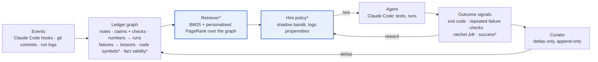

# Target architecture: a learning loop over the ledger

**Status: target, not built.** Version 0.1 has most of the boxes below. What it lacks
is the loop: it does not record what it showed the agent or what happened next, so
nothing can learn from consequences yet. This page names each component, where it
lives in the code today and how we will check that it works. Every component gets
verified on its own before the loop is closed.

The rule behind the design: **a hint is judged by its consequence, not by its
similarity to the prompt.**

`*` = missing or partial in 0.1. Highlighted boxes are new components.

## Components

| # | Component | Job | In the code today | Status |
|---|---|---|---|---|
| 1 | Events | Everything the ledger learns from | `hooks.py`, `plugin/hooks/hooks.json` (session start, prompt, pre-bash, bash failure); `records.py` (git integrity) | **partial**: failures are captured, successes are not; run logs are not read as events |
| 2 | Ledger graph | Notes, links, numbers and their sources, failures and lessons | `corpus.py`, `graph.py`, `provenance.py`, `records.py`, `failures.py`, `lifecycle.py` | **partial**: no executable claims (`checks:`), no note → code-symbol edges, no validity time for facts |
| 3 | Retriever | Candidate notes and failures for a prompt or command | `search.py` (BM25), `context.py` (budget, relative cut-off) | **partial**: BM25 only; PPR over wiki links to be added in shadow first |
| 4 | Hint log | What was shown, with what score and probability, for which prompt and session | `usage.py` logs event, ms, chars and outcome only | **missing**: the prerequisite for everything below |
| 5 | Hint policy | Chooses which candidates to show, or nothing | ranking is fixed inside `context.py` | **missing**: a contextual bandit that runs in shadow beside BM25 |
| 6 | Agent | Does the work | Claude Code (external) | n/a |
| 7 | Outcome signals | Reward without an LLM judge | `hooks.py` tool-failure (exit code), `failures.repeat_failure_rate`, `ratchet.py` | **partial**: no success event, no `checks:` runner, no join of hint → outcome |
| 8 | Curator | Turns outcomes into new records | `records.write_record` (append-only), `failures.add_lesson` (manual) | **partial**: lessons are written by hand; proposals from failure → fix pairs are missing |

## Invariants

1. **The policy decides what to show, never what to write.** Writes stay append-only
   and under the ratchet. A learned memory manager with the right to delete is the
   monolithic rewrite that causes context collapse (Zhang et al., ACE, 2025).
2. **Shadow before live.** The policy is used only after an off-policy estimate on the
   logged data beats BM25 with a confidence interval that excludes zero. Until then
   BM25 serves and the policy only logs its choice.
3. **No LLM judge in the reward.** Rewards come from exit codes, repeated failure
   signatures, named tests and audit metrics.
4. **Hooks never break the turn** (already true in 0.1, `hooks.py`).

## Verification, component by component

Each box is checked on its own before the loop is closed. A component is "verified"
when it has a test and a measurement on a real vault.

- [ ] **Events.** Success hook (`PostToolUse`, exit 0) is captured; a failure followed
      by a success of the same command produces one failure → fix pair.
- [ ] **Graph.** Issue identities are stable across rewraps (done in 4eb63c8, measured
      on 61 commits: spurious churn 29.3% → 6.4%). Still to check: links to targets
      outside `docs/`, which inflate the dangling count.
- [ ] **Retriever.** BM25 vs PPR on the demo vault and a real vault, with the choice
      logged but not shown.
- [ ] **Hint log.** Every attached note has an id, score, probability, prompt hash and
      session id; the log joins to outcomes.
- [ ] **Policy.** Off-policy estimate (IPS / doubly robust) against BM25 on the logged
      data, with a bootstrap interval.
- [ ] **Outcome signals.** `checks:` runner; reward computed for every logged hint.
- [ ] **Curator.** Lesson proposals from failure → fix pairs, accepted by hand at first.

## Phases

1. **Data (weeks 1–4).** Hint log and success hook for the author and 2–3 early users.
2. **Offline evaluation (weeks 5–7).** Bandit vs BM25 vs PPR on the log.
3. **LintBench v0 (weeks 6–10, in parallel).** A benchmark of vault upkeep built from
   git history and synthetic corruptions.
4. **Weights (weeks 10–13, only if phases 2–3 show a signal).** GRPO on a small model
   for one narrow action.

See [ROADMAP.md](ROADMAP.md) for the feature list this loop sits on.
